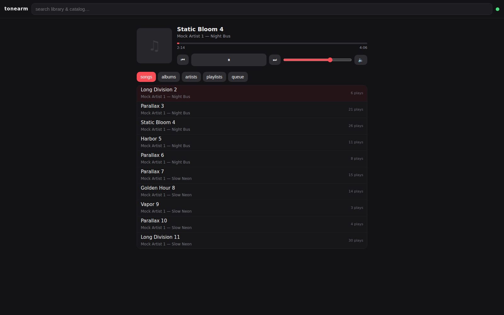

# tonearm 🎧

[](https://github.com/CloudCompile/tonearm/actions/workflows/ci.yml)
[](LICENSE)
[](requirements.txt)

**A personal, self-hosted Apple Music API.** tonearm drives your own logged-in
Apple Music web player session through Chrome DevTools and exposes it as a
clean local REST API — including corners of Apple's API that aren't officially
documented.

> ⚠️ **Unofficial.** Not affiliated with Apple. tonearm automates *your own*
> account, for *your own* use — it holds your session the same way your
> browser does. That's a gray zone in Apple's ToS; use your judgment and keep
> it private/local.

## How it works

```
your code ──HTTP──▶ tonearm (FastAPI, localhost) ──CDP──▶ Chrome (your session)
                                                          │
                                                          ▼
                                                amp-api.music.apple.com
                                          (MusicKit, your auth tokens)
```

The web player ships a full MusicKit client with your auth. tonearm attaches to
that page over CDP and evaluates calls in it — so there are **no tokens to
manage**: your session lives in a Chrome profile, exactly like a normal login.
Sign in once, and everything the web player can do becomes an API.



## Try it in 30 seconds — no Apple account

tonearm has a **mock mode**: the entire API and the bundled PWA run on
synthetic data, zero credentials, zero Chrome. This is also how CI tests
itself.

```bash
git clone https://github.com/CloudCompile/tonearm && cd tonearm
pip install -r requirements.txt
TONEARM_MOCK=1 python3 -m tonearm
# → PWA at http://127.0.0.1:8188 · API docs at /docs
```

Browse the mock library, drag the queue, watch the playhead move — then point
`curl` at it:

```bash
curl http://127.0.0.1:8188/api/library/songs?limit=5
```

When you're ready for the real thing, see Setup. Your Apple session stays in
a Chrome profile; nothing is downloaded, nothing is shared.

## Setup

```bash
pip install -r requirements.txt

# 1. one-time: sign in (opens a visible Chrome window)
python -m tonearm.login

# 2. serve (headless by default)
python -m tonearm
# → API docs at http://127.0.0.1:8188/docs
```

## Endpoints

### Library (read) — `/api/library/…`

| Endpoint | Description |
|---|---|
| `GET /library/{resource}?limit&offset&term&extend` | list any resource: `songs`, `albums`, `artists`, `playlists`, `music-videos`, `stations` — fully paginated by the caller |
| `GET /library/{resource}/{id}` | one item, **including its relationships** (e.g. an album's tracks) |
| `GET /library/{resource}/{id}/{relationship}?limit&offset` | a relationship collection, e.g. `artists/{id}/albums` |
| `GET /library/search?term=` | search *your* library (songs/albums/artists/playlists) |
| `GET /library/recently-added?limit` | most recent additions |
| `GET /library/playlists/{id}/tracks` | every track of a playlist (auto-paginated to the end) |
| `GET /library/export` | full backup: every song + every playlist with its tracks (~3 min for a 9k library) |
| `GET /library/diff?since=&what=` | what changed since a unix timestamp (added/updated/removed) — computed from the local store's snapshot walks; `501` unless `TONEARM_STORE=1` |

Every item is normalized (`id`, `catalog_id`, `library_id`, `name`, `artist`,
`album`, `artwork` at 600×600, …) **and** carries Apple's full raw
`attributes` blob, so nothing the API exposes is hidden.

### History — `/api/history/…` (the local archive, `TONEARM_STORE=1` → else `501`)

Apple's recently-played caps at ~20 items and erodes; the local store keeps
everything from the moment you enable it (no backfill — coverage starts at
opt-in).

| Endpoint | Description |
|---|---|
| `GET /history/recently-played?limit&offset` | every play since `TONEARM_STORE=1` was first enabled, newest first |
| `GET /history/stats?window=day\|week\|month\|all` | top tracks + artists from YOUR play archive (SQL aggregation, no Apple calls) |
| `GET /history/stats/series?days=` | plays per UTC day — chart-ready |

### Catalog (read) — `/api/catalog/…`

| Endpoint | Description |
|---|---|
| `GET /catalog/search?term=&types=&limit` | multi-type catalog search (`songs,albums,artists,playlists,stations,curators,music-videos`) |
| `GET /catalog/charts?types=&limit&genre` | top charts |
| `GET /catalog/{resource}?ids=` | fetch items by id |
| `GET /catalog/{resource}/{id}?extend=` | one item (`extend=tracks` inlines its content) |
| `GET /catalog/{resource}/{id}/{relationship}` | e.g. `artists/{id}/albums` |
| `GET /catalog/songs/{id}/lyrics?raw=` | synced lyrics, parsed to `[{timeMs, text}]` (or `raw=1` for the TTML) |
| `GET /catalog/hints?term=&types=` | autocomplete suggestions (what the player's search box shows) |

### Personal — `/api/personal/…`

| Endpoint | Description |
|---|---|
| `GET /personal/recommendations` | For You / Listen Now groups |
| `GET /personal/heavy-rotation` | what you've had on repeat |
| `GET /personal/recently-played` | recently played |
| `GET /personal/made-for-you` | Apple's auto-generated mixes |

### Favorites

| Endpoint | Description |
|---|---|
| `GET /api/favorites` | every song in your auto-generated *Favorite Songs* playlist |

### Playback — `/api/playback/…`

| Endpoint | Description |
|---|---|
| `GET /now-playing` | title/artist/album/artwork/playhead — full metadata |
| `POST /play\|pause\|toggle\|next\|previous` | transport controls |
| `POST /play-song/{catalog_id}` | play a catalog song |
| `POST /play-collection?kind=album\|playlist\|station&id=` | queue and play a whole collection |
| `POST /play-next?catalog_id=` · `POST /play-later?catalog_id=` | queue inserts |
| `GET /queue` | current queue |
| `GET /settings` · `GET /volume` | shuffle / repeat / volume / state |
| `POST /volume/{0..1}` · `POST /shuffle/{on,off}` · `POST /repeat/{0,1,2}` | set them |

### Sweeps — `/api/write/sweeps/…` (batch ops, dry-run by default)

| Endpoint | What it does |
|---|---|
| `GET /sweeps/dedupe` | plan: duplicate library rows (same catalog id or same name+artist+duration) |
| `POST /sweeps/dedupe?execute=1` | remove all-but-first row of each dup group |
| `GET /sweeps/rate?artist=&album=&limit=` | plan: which songs a batch-heart would touch |
| `POST /sweeps/rate?artist=creo&execute=1` | heart them (skips already-hearted; never clears) |
| `GET /sweeps/never-played` | read-only report (Apple's API doesn't expose play counts — flagged when so) |
| `GET /sweeps/digest` | one walk → dedupe + never-played summary; the same payload `sweep.digest` webhooks carry on schedule |

Every sweep returns a PLAN unless `execute=1`. A full library walk is
~100 s for a 9k-song library; sweep calls are slow by design.

### Smart playlists — `/api/smartlists/…` (rule sets → live playlists, needs `TONEARM_STORE=1`)

| Endpoint | Description |
|---|---|
| `GET /smartlists` | definitions + last evaluation/sync state |
| `POST /smartlists` | create: `{name, rules: [{field, op, value}], sort?, limit?, refresh_s?}` — rules validated, bad rule = 400 |
| `GET /smartlists/{id}` / `PATCH` / `DELETE` | manage a definition (DELETE keeps any materialized Apple playlist) |
| `GET /smartlists/{id}/preview` | evaluate NOW against the local store — zero Apple calls |
| `POST /smartlists/{id}/refresh` | materialize: find-or-create the playlist, one full-list PUT so Apple matches the evaluation exactly |

Rule dialect (all rules AND; evaluation is **local-only** — Apple is
touched only at materialization, writes-gated + throttled):

| field | ops |
|---|---|
| `title` / `artist` / `album` | `contains` `equals` `starts` `ends` (case-insensitive) |
| `genre` | `contains` |
| `play_count` | `eq` `gt` `gte` `lt` `lte` (absent data never matches) |
| `release_date` / `added` | `after` `before` (ISO `YYYY-MM-DD`; `added` reads the store watermark) |
| `last_played` | `within_days` `older_than_days` `never` (joined against the play archive on both id spaces) |

Sorts: `added_desc` (default), `added_asc`, `name`, `artist`,
`play_count_desc`, `release_date_desc`.

### Release watcher — `/api/watcher` (`TONEARM_WATCHER=1`, **verify-live gate**)

| Endpoint | Description |
|---|---|
| `GET /watcher` | watched artists, mapping coverage (`mapped`/`unmapped` is honest), last pass summary |
| `POST /watcher/refresh` | one bounded pass, synchronously (same code the scheduler runs) |

The watcher polls **library artists** daily (`TONEARM_WATCHER_INTERVAL=86400`),
maps each to a catalog artist by strict name search, and emits a
`release.found` webhook when a newer album appears. **Gate, stated
plainly**: the library-artist → catalog-artist mapping surface is
undocumented and the name-search strategy is unverified against a real
Apple account — the feature ships OFF, the first pass is a silent
baseline, and you should run a manual `POST /refresh` and eyeball
`GET /watcher` (mapped vs unmapped) before trusting it.


### Automation — `/api/webhooks/…` (outbound webhooks, `TONEARM_WEBHOOKS=1` → else `501`)

| Endpoint | Description |
|---|---|
| `GET /webhooks` | configured hooks (secrets redacted as `has_secret`), pending count, last deliveries |
| `POST /webhooks` | add a hook: `{url, events?, secret?, enabled?}` — adding an existing URL updates it |
| `PATCH /webhooks/{id}` | partial update (`url` / `events` / `secret` / `enabled`); `secret: ""` clears signing |
| `DELETE /webhooks/{id}` | remove a hook |
| `POST /webhooks/{id}/test` | deliver a `webhook.test` event right now — synchronous, no retry |
| `GET /webhooks/deliveries?limit=` | recent delivery attempts, newest first (retries included) |

### Streaming — `/api/stream` (SSE) + `/demo`

```text
GET /api/stream        # text/event-stream
  event: snapshot      # full player state on connect
  event: update        # every change: play/pause, track, ~1/s progress,
                       # queue changes, shuffle/repeat, volume
```

One `EventSource` drives a whole custom UI — no polling loops. Every event
carries a complete mini-snapshot (title, artist, album, art, playhead,
volume, shuffle/repeat), so clients are dumb renderers.

**A working demo ships at `/demo`** — a single-file remote control
(now-playing card, transport, volume, queue) built on nothing but the
public API. ~100 lines of HTML/JS: use it, or steal it as a starting point
for your own UI. It stays readable when `TONEARM_API_KEY` is set via
`/demo?api_key=…` and `/api/stream?api_key=…`.

### Metrics — `/metrics` (Prometheus)

```prometheus
tonearm_cdp_eval_duration_seconds_bucket{le="5"} …   # renderer latency
tonearm_renderer_consecutive_failures 0              # watchdog stall state
tonearm_renderer_recycles 0                          # dead-tab recoveries
tonearm_apple_requests_total{code="2xx"} …           # Apple error rates
tonearm_stream_listeners / tonearm_audio_listeners …    # live clients
tonearm_queue_depth_last …                           # last-known queue depth
```

Zero dependencies, plain text exposition. The scrape path **never touches
the renderer** — every series is read from state the watchdog, fetch layer
and stream gauges already maintain. Sits behind `TONEARM_API_KEY` when one is
set (scrape config: `authorization` block with `Bearer <key>`).

### Debug — `/api/debug` (what just happened in there?)

Last 50 raw CDP calls with durations (watchdog pings and stream drains
included), the current music-tab URL, and the renderer health snapshot.
The debug surface never evals the renderer it is diagnosing — everything is
read from memory or Chrome's socket-free HTTP API.

### Audio — `/api/audio/stream.mp3` (the actual sound)

Metadata streaming is great for a remote control on the same machine — but
if the server runs on a VPS and your UI at home wants to **hear** it, set
`TONEARM_AUDIO=1`. tonearm then:

1. runs Chrome on a virtual display (`TONEARM_AUDIO_DISPLAY=:2`) instead of
   headless — headless Chrome has no audio output,
2. routes its audio into a **private** PulseAudio null sink
   (`TONEARM_AUDIO_SINK=tonearm_audio`) — your desktop's audio never mixes in,
3. captures the sink and re-serves it as a live mp3
   (`TONEARM_AUDIO_BITRATE=160k`):

```html
<audio src="http://vps:8188/api/audio/stream.mp3">
```

That's the whole client. ~1–2 s behind the reported playhead (encoder
buffer); the demo's 🔇/🔊 button is the example. Needs `pulseaudio`,
`pulseaudio-utils`, `ffmpeg` and `Xvfb` on the box (the Docker image has
them). `/api/audio/status` reports pipeline state and listener count.

### The web app (PWA) — served at `/`

The API ships with its own installable web app — library browse, search,
queue with drag-reorder, now-playing transport, synced lyrics. It is the
same contract the demo page proved, productized: **no framework runtime**
(the only npm dependency is esbuild, used at build time), virtualized
lists (only the visible window renders), one EventSource driving
everything — it polls nothing the stream already pushes.

```
node web/build.mjs        # bundle -> tonearm/web-dist (gitignored, built in
                          # CI and the Docker image's node stage)
```

### Companion pages — `/ledger` `/radar` `/bench`

Three single-page tools served next to `/demo` (same keyless-shell auth
dialect; the API key, if the server has one, is asked once and kept in
localStorage):

* **/ledger — stats & library health.** Top artists/tracks (7d/30d/all),
  plays-per-day chart, the full local archive with deep pagination, and
  the sweeps as pages: duplicate groups (execute is double-confirmed),
  never-played, the digest. Needs `TONEARM_STORE=1` for the stats half.
* **/radar — new music & releases.** Recently-added, Apple's
  recommendations / made-for-you / heavy rotation, the release watcher's
  state (mapped vs unmapped artists — this page is the watcher's
  verify-live instrument), and an artist lookup that diffs an artist's
  catalog albums against your library with one-click adds.
* **/bench — playlist workshop.** The write surface: playlist editor
  (reorder/remove → full-list PUT), smartlist builder (rules → preview →
  materialize), batch-heart (plan → execute), restore from an export
  file. Every mutation confirms twice; `writes_disabled` envelopes
  surface as honest toasts.


Serve it by just running the server — the app mounts at `/` when
`tonearm/web-dist/` exists, and the API keeps every `/api/…` path.

- **Auth dialect** (#90): the shell loads without a key (a locked-down
  server must still serve its login page); the key you enter is stored in
  `localStorage` and rides **everywhere** — `?api_key=` for EventSource
  (which cannot send headers) and `Authorization: Bearer` for fetch.
- **Service worker** (#90): caches the shell for installability and
  offline starts — and **never** caches `/api/` (a cached playhead or
  audio stream would be a lie).
- **Queue drag** (#87): maps to the whole-list contract —
  `PUT /api/playback/queue` with `{ids: […]}`; the full ordered list,
  last write wins, no deltas.
- **Lyrics** (#89): implements `docs/lyrics-contract.md` verbatim, with
  the ±100 ms offset nudge and a quiet instrumental state on 404.

### Mock mode — `TONEARM_MOCK=1` (no Apple account needed)

```bash
TONEARM_MOCK=1 python -m tonearm        # full API, zero Chrome, zero network
```

The whole surface is served from a **seeded synthetic library** ("Mock
Artist 1" and friends — nothing recorded, nothing real ships in the repo).
Playback is a state machine with a live playhead (the playhead advances,
tracks end and advance the queue); writes actually mutate the fake library
(create a playlist, heart a song — it stays). SSE replays a live event
buffer. Audio honestly 404s (no renderer = no sound).

What it's for: UI development and CI. CI runs a full route-level
integration pass against the mock server (plain urllib — no browser, no
Apple, no TestClient), and every mock response is enforced against the
typed response models, so the fixtures can't rot out of the schema
silently.

### Audio options — formats, loudness, join alignment

The stream stays the live pipe from your session's private sink; formats
are encoder tails on that one source — **one subprocess per format, never
per listener**:

```
/api/audio/stream.mp3    the original URL (libmp3lame)
/api/audio/stream.ogg    Ogg Vorbis
/api/audio/stream.opus   Opus in Ogg (48 kHz) — smallest bandwidth
?bitrate=96k             any <bits>k value per request
?loudnorm=1              EBU R128 loudness normalization (-16 LUFS), or
                         TONEARM_AUDIO_LOUDNORM=1 to default it on
```

Join alignment for mid-song listeners (`X-Tonearm-Join-*` response headers):
the feed starts with a pre-encoded silence pad (`TONEARM_AUDIO_JOIN_PAD=0`
disables) so clients get a deterministic alignment point, and the headers
state the playhead position at join — `X-Tonearm-Join-Playhead-Ms` plus
`X-Tonearm-Join-Stale`, which is `1` when that claim rests on stale stream
state. Degrades loudly, never silently pretends. The capture is a live
pipe: there is no seekable buffer to rewind into.

### Discord Rich Presence — `TONEARM_DISCORD=1`

Running tonearm on a desktop with Discord? Set `TONEARM_DISCORD=1` and
`TONEARM_DISCORD_CLIENT_ID=<your app id>` and the session's now-playing shows
in your presence — track change pushed, progress ticked by Discord's own
end-timestamp, **paused or stalled clears the presence** instead of
freezing a wrong track. Zero new dependencies (raw local IPC); on a
headless box it logs the missing socket and idles harmlessly.

### Last.fm scrobbling — `TONEARM_LASTFM=1`

One-time auth, then it just scrobbles:

```bash
TONEARM_LASTFM_API_KEY=… TONEARM_LASTFM_SECRET=… python -m tonearm.lastfm
#   -> open the URL, approve, Enter — creds saved 0600 next to the store
TONEARM_LASTFM=1 python -m tonearm      # now playing + scrobbles
```

The **50 % / 4-min rule** is computed from the same event buffer the store
drains (elapsedMs/durationMs ride along — nothing extra is asked of Chrome),
each scrobble carries the play's actual **start time**, and the dedupe
marker `UNIQUE(track_id, started_at)` lives in the store's `scrobbles`
table — restarts and buffer replays never double-scrobble. Requires
`TONEARM_STORE=1`.

### Outbound webhooks — `TONEARM_WEBHOOKS=1`

Apple has no webhooks. tonearm can be the webhook: the events the server
already observes are POSTed to URLs you configure, with retries.

```bash
TONEARM_WEBHOOKS=1 python -m tonearm

# register a receiver (same URL again updates it; secrets enable signing)
curl -X POST http://127.0.0.1:8188/api/webhooks \
  -d '{"url": "https://your-endpoint/hook",
       "events": ["track.change", "favorite.added"],   # omit = everything
       "secret": "s3cret"}'

# fire a test delivery right now and see the result
curl -X POST http://127.0.0.1:8188/api/webhooks/<id>/test
```

What fires (all observed state — nothing new is asked of Chrome):

| Event | When |
|---|---|
| `track.change` / `playback.paused` / `playback.resumed` | transitions off the stream-event buffer |
| `favorite.added` / `favorite.removed` / `rating.changed` | write ops |
| `library.added` / `library.removed` / `library.album.*` | write ops |
| `playlist.created` / `playlist.tracks.added` / `playlist.tracks.replaced` / `playlist.renamed` / `playlist.deleted` / `playlist.restored` | write ops |
| `library.changed` | a snapshot walk found adds/updates/removals (needs `TONEARM_STORE=1`) |
| `renderer.stalled` / `renderer.recovered` | watchdog declared the tab dead / recycled it |
| `library.deduped` / `library.rated` | sweep executions |
| `sweep.digest` | the scheduled digest (below) |
| `release.found` | the release watcher found a newer album than last seen (below — verify-live gate) |
| `smartlist.updated` | a smart playlist was re-materialized to match its rules (below) |
| `webhook.test` | the test endpoint |

Delivery contract:

* **Payload** is `{"id": "evt_…", "type": …, "created_at": …,
  "tonearm_version": …, "data": {…}}`. Delivery is **at-least-once** — dedupe
  on `id` (stable across retries). Headers: `X-Tonearm-Event`,
  `X-Tonearm-Delivery`, `X-Tonearm-Attempt`, `X-Tonearm-Timestamp`.
* **Signing**: with a `secret`, every delivery carries
  `X-Tonearm-Signature: sha256=<hex>` — HMAC-SHA256 over
  `<X-Tonearm-Timestamp>.<raw body>`. Receivers should ALSO check the
  timestamp is fresh (say, ±300s) so an old signed body can't be replayed.
  **Rotation**: set a new secret via `PATCH /api/webhooks/{id}` and have the
  receiver accept either secret during the cutover — deliveries never stop.
* **Retries**: network errors, timeouts, 429 and 5xx retry on
  2s/10s/30s/120s/600s; other 4xx dead-letter immediately (retrying a 400
  forever is how you become a spammer). After 3 consecutive dead letters a
  URL is **parked** for 15 min (`TONEARM_WEBHOOK_PARK_AFTER` /
  `TONEARM_WEBHOOK_PARK_S`) — it stops receiving events until the cooldown
  passes; the first real success resets the streak. Pending deliveries are
  in-memory — a restart drops them, stated plainly. Delivery status lives in
  `GET /api/webhooks` and `/api/debug` (per-hook last attempt + parked flag).
* **Secrets stay secret**: the management surface reports `has_secret`, never
  the secret; the hook list is a 0600 JSON file on your volume.
* **SSRF is yours to manage**: tonearm will POST anywhere you point it —
  internal service URLs are a *feature* (that's how it reaches Home
  Assistant on your LAN), just don't point it at anything you wouldn't hand
  your library metadata to.

Minimal Flask receiver that verifies the signature:

```python
import hmac, hashlib, time
from flask import Flask, request, abort
app = Flask(__name__)
SECRET = b"s3cret"

@app.post("/hook")
def hook():
    ts = request.headers.get("X-Tonearm-Timestamp", "")
    if abs(time.time() - float(ts or 0)) > 300:          # freshness check
        abort(400)
    expected = "sha256=" + hmac.new(SECRET, f"{ts}.".encode() +
                                    request.get_data(), hashlib.sha256).hexdigest()
    if not hmac.compare_digest(request.headers.get("X-Tonearm-Signature", ""),
                               expected):
        abort(403)
    print(request.headers["X-Tonearm-Event"], request.json["data"])
    return "ok"
```

| Endpoint | Description |
|---|---|
| `GET /webhooks` | hooks (secrets redacted) + per-hook delivery stats + recent attempts |
| `POST /webhooks` | add a hook `{url, events?, secret?, enabled?}` — same URL updates |
| `PATCH /webhooks/{id}` | change url/events/secret/enabled (omitted fields stay) |
| `DELETE /webhooks/{id}` | remove a hook |
| `POST /webhooks/{id}/test` | synchronous one-shot `webhook.test` — the answer, not a background retry |
| `GET /webhooks/deliveries?limit=` | the last N delivery attempts, retries included |

`501` (`webhooks_disabled`) until `TONEARM_WEBHOOKS=1`.

### Scheduled sweep digests — `TONEARM_DIGEST_INTERVAL`

Set both flags and the sweeps go ambient:

```bash
TONEARM_WEBHOOKS=1 TONEARM_DIGEST_INTERVAL=86400 python -m tonearm
```

Every N seconds one dry-run library walk becomes a `sweep.digest` webhook
event — library size, duplicate groups + removable rows, never-played count
with samples. The same payload is available on demand at
`GET /api/write/sweeps/digest` (no flags needed — it's a read). One walk
feeds both reports; the walk is stall-gated and never overlaps itself.

### Smart playlists — `TONEARM_SMARTLIST_INTERVAL` (needs `TONEARM_STORE=1`)

Define rules once, get a live playlist:

```bash
curl -X POST http://127.0.0.1:8188/api/smartlists \
  -H 'Content-Type: application/json' \
  -d '{"name": "Aurora — not played lately",
       "rules": [{"field": "artist", "op": "equals", "value": "aurora"},
                 {"field": "last_played", "op": "older_than_days", "value": 30}],
       "sort": "play_count_desc", "limit": 25}'

curl -X POST http://127.0.0.1:8188/api/smartlists/<id>/preview   # local eval, no Apple
curl -X POST http://127.0.0.1:8188/api/smartlists/<id>/refresh   # find-or-create + full PUT
```

Evaluation is **local-only** (the store's library rows + play archive —
zero Apple calls); materialization touches Apple only through
`TONEARM_ENABLE_WRITES=1` and is throttled per list
(`TONEARM_SMARTLIST_MIN_REFRESH`, floor 300s — a full-list PUT rebuilds
the playlist on Apple's side). Set `TONEARM_SMARTLIST_INTERVAL=3600` to
have the scheduler re-evaluate and sync on a cadence; 0 (default) means
manual refresh only. Each sync emits a `smartlist.updated` webhook.

### New-release watcher — `TONEARM_WATCHER=1` (verify-live gate)

```bash
TONEARM_WEBHOOKS=1 TONEARM_WATCHER=1 python -m tonearm
# optionally: TONEARM_WATCHER_PLAYLIST="New Music (auto)" + TONEARM_ENABLE_WRITES=1
#   → a found release's tracks are appended to that playlist (#108)
```

A daily (`TONEARM_WATCHER_INTERVAL=86400`) bounded pass over library
artists: map each to a catalog artist by strict name search, read its
newest catalog album, emit `release.found` when it's newer than the last
one seen. The first pass is always a **silent baseline**. **The mapping
strategy is the unverified part** — the surface is undocumented; eyeball
`GET /api/watcher` (mapped vs unmapped) and `POST /api/watcher/refresh`
after a live login before trusting it. See ROADMAP.

### Home Assistant — recipes, not an integration

`docs/ha-recipes.md` has copy-paste YAML for both directions: tonearm
webhook events driving HA automations (dim lights on pause, page on
`renderer.stalled`, phone-notify on `release.found`), and HA calling the
API back (`rest_command` transport buttons, a polled now-playing sensor).


### OBS overlay — `/api/overlay`

Now-playing for streamers, served from the SSE stream's last emitted state
(zero extra Chrome evals — it piggybacks on data the stream already fetched):

```
/api/overlay/now-playing.json        typed payload (title, artist, elapsedMs, id, …)
/api/overlay/now-playing.txt         one text line for OBS's Text source
?format={title} by {artist} [{elapsed}]   — template the text flavor
```

Point an OBS **browser source** at the `.json` URL (with
`Authorization: Bearer <key>` as a custom header when `TONEARM_API_KEY` is
set). Before any stream client has connected, the payload is honest nulls —
the overlay never drives Chrome itself.

### Typed API & generated clients

Every JSON route declares a Pydantic response model (enforced by a CI
conformance check), so `/openapi.json` is real: 60 schemas, and the auth
dialect documented (`Authorization: Bearer <key>` **or** `?api_key=<key>` —
the fallback EventSource needs since it cannot send headers).

On every release tag, CI regenerates clients from that schema into
[`clients/`](clients/) — TypeScript (`clients/ts/schema.ts`, openapi-typescript)
and Python (`clients/python/`, the `tonearm-client` package):

```python
from tonearm_client import AuthenticatedClient
from tonearm_client.api.library import list_resource_api_library_resource_get as songs

client = AuthenticatedClient(base_url="http://127.0.0.1:8188", token="<key>")
page = songs.sync(client=client, resource="songs", limit=10)
```

Generated code is GENERATED — banners mark it, hand-edits are rejected.
Client versions track the server release.

### The escape hatch

```
ANY /api/amp-api/{any apple music api path}?{query}
```

Forwards your request to `amp-api.music.apple.com` with your tokens injected.
Any method, any path — if the web player can do it, this can too:

```bash
curl 'http://127.0.0.1:8188/api/amp-api/v1/me/library/songs?limit=5'
```

### Writes — `/api/write/…` (ALL disabled by default → `501`)

`POST/DELETE /write/favorites/{id}?library_key=` · `GET/PUT /write/ratings/songs/{id}?rating=like|none` ·
`POST /write/library/add` (body: bare JSON array of catalog ids) ·
`POST /write/library/add-albums` (albums — note: Apple is flaky, the songs
usually arrive but the album container row may never appear) ·
`DELETE /write/library/{library_song_id}` ·
`DELETE /write/library/albums/{library_album_id}` (whole album, all songs) ·
`POST /write/playlists?name=&description=` ·
`POST /write/playlists/{id}/tracks` (body: catalog id array — auto-adds songs to your library) ·
`PUT /write/playlists/{id}/tracks` (body: bare JSON array of **library** ids, full ordered
list — this is both reorder and removal) ·
`PATCH /write/playlists/{id}?name=&description=` · `DELETE /write/playlists/{id}` ·
`POST /write/restore` (body: a `/library/export` JSON — **dry-run plan by default**, `?execute=1` applies:
creates missing playlists, adds tracks, verifies counts async; every un-restorable row is listed with a reason)

Every mutation returns `501` until you set `TONEARM_ENABLE_WRITES=1`. All shapes
above were validated live against a real account.

### Multi-user keys — `python -m tonearm keys` (v0.7)

Hand the link to friends without handing them your write power:

```bash
python3 -m tonearm keys add laptop --scopes read        # a friend's UI: watches only
python3 -m tonearm keys add phone  --scopes read,write  # yours: full control
python3 -m tonearm keys list                            # ids + scopes, never hashes
python3 -m tonearm keys revoke k-ab12cd34
```

* **Scopes**: `read` (GETs) vs `write` (every mutation — playback control
  included: a friend's UI watches, yours drives). `write` implies `read`.
* **Ceilings**: `--rate 120` = requests/min for that key — over it, `429
  rate_limited` + `Retry-After`. The master (`TONEARM_API_KEY`) is never
  limited.
* **SSE caps**: 3 concurrent live-stream connections per key (`TONEARM_SSE_CAP`).
* Stored as **hashes** in a 0600 file; the raw key is shown once. Added
  keys work without restarting the server.
* **`GET /api/audit`** (master only): who did what — every authenticated
  mutation, newest first, exportable; store-backed when `TONEARM_STORE=1`,
  a 1000-entry ring otherwise (stated in the response).
* `/health` now carries **`session`** — `ok` / `expired` / `unknown`: when
  Apple's session dies, the API says `502 session_expired — run
  `python -m tonearm login`` instead of scattered 403s (#189).

### Errors — one shape everywhere

Every non-2xx response, from any route, is:

```json
{"error": {"code": "renderer_unavailable", "hint": "the renderer is busy or stalled — it usually recovers on its own; retry shortly"}}
```

| Code | Meaning | What a client should do |
|---|---|---|
| `bad_request` | missing/invalid parameters | fix the request; the hint names the problem |
| `unauthorized` | bad or missing API key | send `Authorization: Bearer <key>` (`?api_key=` for EventSource) |
| `not_found` | no such resource or route | don't retry — nothing is there |
| `rate_limited` | Apple rate-limited a read | honor `Retry-After`; tonearm already backs off internally |
| `disabled` | feature flag off (`501`) | the hint names the env variable |
| `writes_disabled` | mutations off | set `TONEARM_ENABLE_WRITES=1` if you accept the risk |
| `store_disabled` | local store off | set `TONEARM_STORE=1` |
| `webhooks_disabled` | outbound webhooks off | set `TONEARM_WEBHOOKS=1` |
| `renderer_unavailable` | Chrome tab busy/stalled (`502`) | retry shortly — stalls usually recover in ~60s |
| `degraded` | renderer failing watchdog checks (`503`) | see `/health`; the watchdog recycles dead tabs |

## Configuration (env vars)

| Variable | Default | Meaning |
|---|---|---|
| `TONEARM_PROFILE` | `~/.config/tonearm/chrome-profile` | Chrome profile used for your session |
| `TONEARM_CDP_URL` | `http://127.0.0.1:9222` | Chrome debug endpoint (attach or launch) |
| `TONEARM_AUTO_CHROME` | `1` | launch Chrome automatically if not reachable |
| `TONEARM_HEADLESS` | `1` | headless chrome (set `0` for audible playback) |
| `TONEARM_HOST` / `TONEARM_PORT` | `127.0.0.1` / `8188` | bind address |
| `TONEARM_API_KEY` | *(unset)* | the MASTER key — full access, never rate-limited. Scoped keys for friends live in the keys file (below) |
| `TONEARM_KEYS_FILE` | next to the store db | the multi-key registry (0600 JSON, hashes only) |
| `TONEARM_SSE_CAP` | `3` | concurrent live-stream connections per scoped key |
| `TONEARM_STRICT_BIND` | `0` | make a non-localhost bind **without** `TONEARM_API_KEY` fatal instead of a loud warning (default warn-only — inside a container, binding `0.0.0.0` is normal; the port mapping is the boundary) |
| `TONEARM_ENABLE_WRITES` | `0` | unlocks favorite/playlist mutations |
| `TONEARM_CACHE` / `TONEARM_CACHE_TTL` | `1` / `30` | read cache for amp-api GETs (single-flight coalesced; catalog 10×, favorites/ratings capped at 10s; mutations bust everything and open an 8s no-cache grace window — see `tonearm/cache.py`) |
| `TONEARM_FAV_PLAYLIST` | `Favorite Songs` | name of the favorites auto-playlist |
| `TONEARM_AUDIO` | `0` | stream the actual audio at `/api/audio/stream.mp3` |
| `TONEARM_AUDIO_DISPLAY` | `:2` | virtual display for audible chrome |
| `TONEARM_AUDIO_SINK` | `tonearm_audio` | private pulse sink to capture |
| `TONEARM_AUDIO_BITRATE` | `160k` | mp3 bitrate of the audio stream |
| `TONEARM_STORE` | `0` | local sqlite store: play archive, library snapshots, diff/stats (`/api/history/…`, `/api/library/diff`) |
| `TONEARM_STORE_PATH` | `/data/tonearm.db` in docker, else `~/.local/share/tonearm/` | where the store db lives |
| `TONEARM_STORE_SYNC_INTERVAL` | `21600` | seconds between library snapshot walks (single-flight, stall-gated) |
| `TONEARM_EXPORT_INTERVAL` | `0` | seconds between scheduled full exports (`0` = off); atomic writes to `TONEARM_EXPORT_DIR` |
| `TONEARM_EXPORT_KEEP` | `7` | keep the newest N scheduled exports, prune older |
| `TONEARM_MOCK` | `0` | **mock mode** — serve the whole API from seeded synthetic fixtures; no Apple account, no Chrome, no network |
| `TONEARM_DISCORD` | `0` | Discord Rich Presence (needs a local Discord client) — requires `TONEARM_DISCORD_CLIENT_ID` |
| `TONEARM_LASTFM` | `0` | Last.fm scrobbler (needs `TONEARM_STORE=1`; auth via `python -m tonearm.lastfm`) |
| `TONEARM_WEBHOOKS` | `0` | outbound webhooks: manage via `/api/webhooks`, retries with backoff, HMAC signing |
| `TONEARM_WEBHOOKS_FILE` | next to the store db | where the hook list lives (0600 JSON) |
| `TONEARM_WEBHOOK_ATTEMPTS` | `5` | max delivery attempts per hook (2s/10s/30s/120s/600s backoff; 4xx dead-letters) |
| `TONEARM_WEBHOOK_TIMEOUT` | `10` | per-attempt HTTP timeout, seconds |
| `TONEARM_WEBHOOK_PARK_AFTER` / `TONEARM_WEBHOOK_PARK_S` | `3` / `900` | park a URL after N consecutive dead letters for this many seconds |
| `TONEARM_DIGEST_INTERVAL` | `0` | seconds between scheduled `sweep.digest` webhooks (`0` = off; needs `TONEARM_WEBHOOKS=1`) |
| `TONEARM_WATCHER` | `0` | new-release watcher: poll library artists, emit `release.found` on a newer album (**verify-live gate** — mapping strategy unverified, see ROADMAP) |
| `TONEARM_WATCHER_INTERVAL` | `86400` | seconds between watcher passes (daily) |
| `TONEARM_WATCHER_MAX_ARTISTS` | `100` | catalog lookups per pass (mappings cached; later passes rotate) |
| `TONEARM_WATCHER_PLAYLIST` | *(unset)* | auto-add a found release's tracks to this playlist (needs `TONEARM_ENABLE_WRITES=1` too) |
| `TONEARM_SMARTLIST_INTERVAL` | `0` | seconds between smart-playlist re-evaluate + sync sweeps (`0` = manual refresh only; needs `TONEARM_STORE=1`) |
| `TONEARM_SMARTLIST_MIN_REFRESH` | `300` | floor on a single list's materialization cadence (a full-list PUT rebuilds it) |

## Field notes (the parts the docs won't tell you)

Things learned by driving a real account — encoded in the code so you don't
have to rediscover them:

* **Top-level JS declarations leak.** Chrome keeps `const`/`let` from previous
  `Runtime.evaluate` calls; a redeclaration throws and kills your loop. Always
  IIFE-wrap evals.
* **The favorites endpoint is key-sensitive.** Catalog songs unfavorite via
  `ids[songs]=<catalogId>`, but some library tracks are keyed by their
  *library* id: `ids[library-songs]=i.XXX`. A wrong-key `DELETE` still returns
  `204` — silently doing nothing. Always verify with a fresh read.
* **Library playlists paginate via `next` links**; the web UI's DOM, by
  contrast, is virtualized and will lie to any scraper that trusts what's
  rendered.
* **Playlist track removal and reorder are one call.** `DELETE …/tracks`
  always 400s ("No mode supplied" — nobody knows what mode is). Instead,
  `PUT` the *entire* ordered library-id list: omitted tracks are removed,
  a different order is a reorder. Catalog ids don't work here — only
  `library-songs` ids.
* **Adding a catalog song to a library playlist silently adds it to your
  library.** Deleting the playlist does not undo that.
* **Library adds are 202-async** — the song appears (and can create a
  library-album row for its single) a few seconds later. Verify with a
  retried read, not the response code.
* **Ratings: like or nothing.** `PUT /v1/me/ratings/songs/{id}` with
  `{"value": 1}` = like; `DELETE` clears. A dislike value is *accepted*
  but silently stores as 1 — so tonearm doesn't expose it.
* **A heart IS a rating.** Favoriting a song is just `value: 1` on the
  ratings endpoint — so `DELETE` on a rating *removes a heart the user
  set*. Never clear a rating "to verify"; read the prior value first.
  (This bit us once: a test cleared a pre-existing favorite.)
* **No favorites sync needed.** Apple auto-collects hearts into a
  "Favorite Songs" library playlist within seconds of hearting, and
  un-hearts leave just as fast. tonearm only reads it.
* **MusicKit memoizes `api.music` GETs** — a read right after a mutation
  returns the stale cached response, and cache-busting with `_=` gets
  rejected ("Parameter '_' is not allowed"). tonearm reads via raw
  token-injected fetches instead.
* **Apple's `next` links drop the `limit` param.** Follow them as-is and
  every page after the first silently shrinks to 25 rows — and a naive
  page cap makes you believe the library ends long before it does
  (tonearm's author thought 1,325 songs; the truth was 9,045). tonearm
  re-applies the original limit on every page.
* **`match=` is a MusicKit-client-only extension** — the raw amp-api
  rejects it (400 "Parameter 'match' is not allowed"). Filter locally.
* **A favorite toggle for songs without a catalog page** (odd uploads /
  region-blocked entries) is only reachable through the library-keyed form.
* **Empty playlists 404 on their tracks relationship** ("No related
  resources found") — Apple says 'no tracks' by saying 'not found'.
* **Album adds are half-real.** `POST /v1/me/library?ids[albums]=…` 202s,
  the songs usually materialize, the library-album container row often
  never does. Verify what actually landed.
* **Leaked tabs zombify Chrome.** Dozens of automation tabs → renderers stop
  answering → evals hang for the full socket timeout. tonearm reuses a single
  tab and closes sockets with a short timeout on purpose.
* **A stalled renderer stalls evals.** Under heavy parallel load Apple's page
  can stop answering `Runtime.evaluate` for ~60s (it recovers on its own).
  tonearm's CDP layer is built for that: reconnects are flat (never recursive —
  a recursive reconnect once starved the whole thread pool, `/health` with
  it), every eval is hard-bounded, lock waiters fast-fail with 502 instead of
  queueing behind a zombie eval, and SSE clients ride out stalls with backoff
  instead of dropping. Expect a burst of 502s, then full recovery — not a hang.
* **The watchdog heals while you're idle.** A background pinger touches the
  tab every 20s (`/health` carries its snapshot). Only 3 *consecutive* failed
  pings (~60s — the length of a recoverable stall) count as a dead tab; then
  it recycles and hot-reconnects, so the first call after a zombie event
  succeeds instead of failing. Disable with `TONEARM_WATCHDOG=0`.
* **Apple's rate limit is honored, with hard limits of its own.** A 429 on a
  GET retries up to twice, sleeping `min(Retry-After, 5s)` — outside the
  browser lock, so other callers proceed while we wait. Mutations never
  auto-retry: a wrong-key favorites DELETE returns `204` and does NOTHING,
  so a blind retry would just mask state (verify externally instead). And
  only HTTP 200s are ever cached — a cached 404/429 would serve a
  not-yet-applied snapshot across Apple's async mutation window.

## Roadmap

Development happens in phases — see **[ROADMAP.md](ROADMAP.md)** for the full
plan (effort- and priority-tagged, with non-goals stated honestly).

* **v0.1 — shipped**: full read surface (library/catalog/personal/favorites,
  lyrics, export), playback + queue, SSE state streaming, live audio
  streaming, write ops with net-zero-tested sweeps, Docker + deploy guides,
  live test suite, CI
* **v0.2 — Bulletproof — shipped**: renderer watchdog, read cache + request
  coalescing, Docker healthchecks, bind guard, Prometheus `/metrics`,
  `/api/debug`, multi-arch (amd64+arm64) images, Apple 429 backoff
* **v0.3 — Memory — shipped**: local SQLite store (play archive, library
  snapshots, cursors), `/api/library/diff`, `/api/history/*` (recently-played
  + stats + series), scheduled exports with keep-N retention, restore
  (dry-run planner + verified executor)
* **v0.4 — Typed API — shipped**: real Pydantic response models on every
  route, standard error envelope, generated TypeScript + Python clients,
  mock server mode (`TONEARM_MOCK=1`, no Apple account needed)
* **v0.5 — Listening experience — shipped**: installable PWA served from
  the API (library browse, search, queue drag, synced lyrics), opus/ogg +
  loudnorm + playhead-aligned join on the audio stream, OBS overlay,
  Discord Rich Presence, Last.fm scrobbling
* **v0.6 — Automation — shipped**: outbound webhooks (`/api/webhooks`,
  `TONEARM_WEBHOOKS=1` — track changes, write mutations, renderer
  stall/recover, library diffs; retries with backoff, HMAC-SHA256 signing)
  and scheduled sweep digests (`TONEARM_DIGEST_INTERVAL`); smart playlists
  (`/api/smartlists` — local rule evaluation, writes-gated materialization,
  `TONEARM_SMARTLIST_INTERVAL`); scheduled release watcher
  (`TONEARM_WATCHER=1`, daily library-artist poll, `release.found` events,
  optional auto-add — **the artist→catalog mapping strategy is
  name-search and remains verify-live gated**); Home Assistant recipes in
  `docs/ha-recipes.md`
* **The road to 1.0, in trains** (ROADMAP.md carries the detail):
  **v0.7.0** multi-user (scoped keys, audit log) → **v0.8.0** the API
  freeze + docs site (+ batch endpoint, multi-storefront before the
  freeze) → **v0.9.0** install script + offline test harness (+ the
  tunnel-era deploy docs) → **v1.0.0-rc** soak → **v1.0.0**

## Deploying

tonearm is a long-lived process driving a real, logged-in Chrome — that rules
out serverless (Vercel, Lambda, Cloud Run *jobs*): there is no way to keep a
persistent browser session there. Everything else works:

### VPS (the reference setup)

```bash
docker compose up -d --build
curl localhost:8188/health   # -> {"status":"ok","browser":"authorized"}
```

**Prebuilt images** (amd64 **and** arm64 — Raspberry Pi 4/5, Apple Silicon)
publish to ghcr.io on every release tag. On an arm64 host, skip the build:

```bash
docker run -d --name tonearm -p 8188:8188 -v tonearm-data:/data \
  ghcr.io/cloudcompile/tonearm:latest
```

(or set `image: ghcr.io/cloudcompile/tonearm:latest` in compose instead of
`build: .` — everything else, profile volume and login flow included, is
identical).

**Healthchecks.** The image ships with a `HEALTHCHECK` polling `GET /health`
(every 30s, 5s timeout, 3 retries — `/health` is exempt from `TONEARM_API_KEY`,
so it works with a key set). Docker only *marks* the container unhealthy; it
never restarts it on its own. On a VPS, if you want wedged containers to
self-heal, run an autoheal sidecar next to tonearm:

```bash
docker run -d --name autoheal \
  -e AUTOHEAL_CONTAINER_LABEL=all \
  -v /var/run/docker.sock:/var/run/docker.sock \
  willfarrell/autoheal
```

Note what "unhealthy" means here: a stalled renderer usually recovers on its
own (tonearm fast-fails 502s during the stall and heals), so don't wire a
restart loop tighter than the watchdog can ride out — 3 failed checks in a
row (~90s) is the image's threshold, and that's a good minimum.

The Chrome profile lives on the `tonearm-data` volume. To sign in, make a
profile on any machine with a screen, then drop it into the volume:

```bash
# on any desktop with a screen, from a source checkout:
TONEARM_PROFILE=$HOME/tonearm-profile python -m tonearm.login   # sign in, press Enter
# then, from the compose project on the server:
tar -C $HOME/tonearm-profile -c . | docker compose exec -T tonearm tar -x -C /data/.config/tonearm/chrome-profile
```

(The profile is just a Chrome user-data-dir — copying it copies the session.
After a re-login once, the headless server reuses it until Apple logs it out,
which is rare.)

### Railway / fly.io

Same image, same volume mount at `/data` (Railway: "Volumes", fly:
`fly volumes create`). Set `TONEARM_API_KEY` before exposing publicly.

### Render

Works, but needs a **paid persistent disk** mounted at `/data` — the free
tier's ephemeral filesystem wipes your Apple session on every deploy.

### Tunnels (optional)

A tunnel is just a reverse proxy in front of port 8188 — nothing in tonearm
depends on it. If you want one, run cloudflared as a second container with
`--url http://tonearm:8188` and set `TONEARM_API_KEY` first. tonearm itself never
needs to know.

## License

MIT — see [LICENSE](LICENSE).
